# ÉPREUVE TECHNIQUE DE TEST ADRIA PFE 2027
**PAR** : ELCADI HAMZA GLSID 3

**ÉPREUVE** : [PDF](/Test%20ADRIA%20ENSET%202027.pdf)

---
## Partie B — Conception et Architecture
### Diagramme de classes :
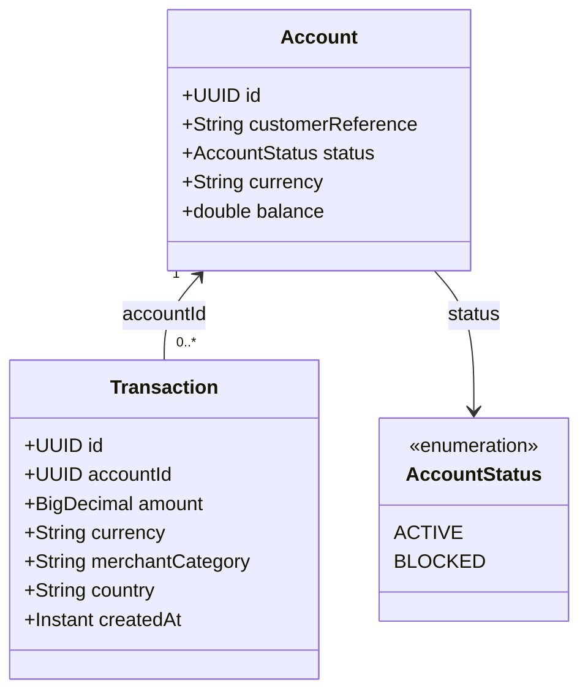

### Schéma d’architecture :
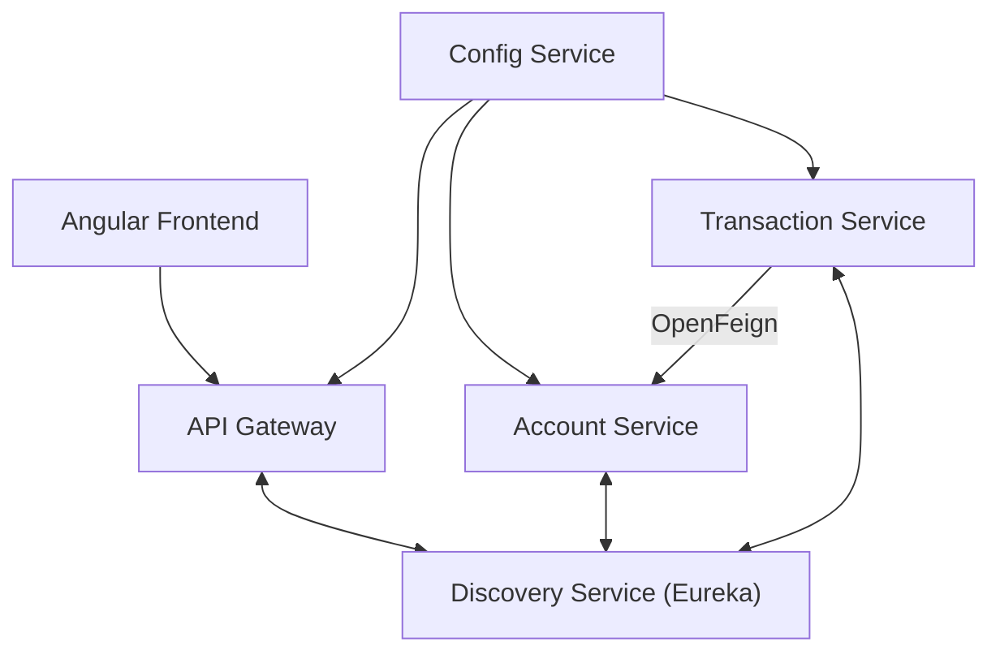

## Partie C — Développer les micro-services fonctionnels en les exposant via des connecteurs REST, GraphQL :
### Account-Service :
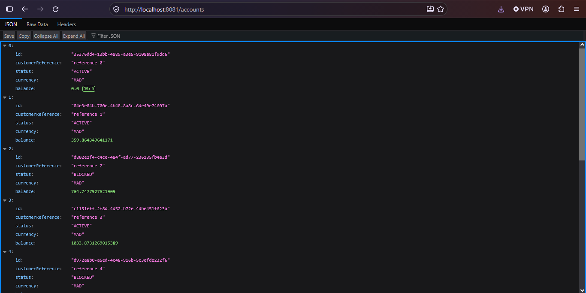 \
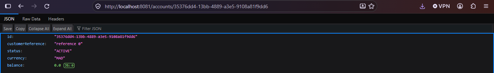 \
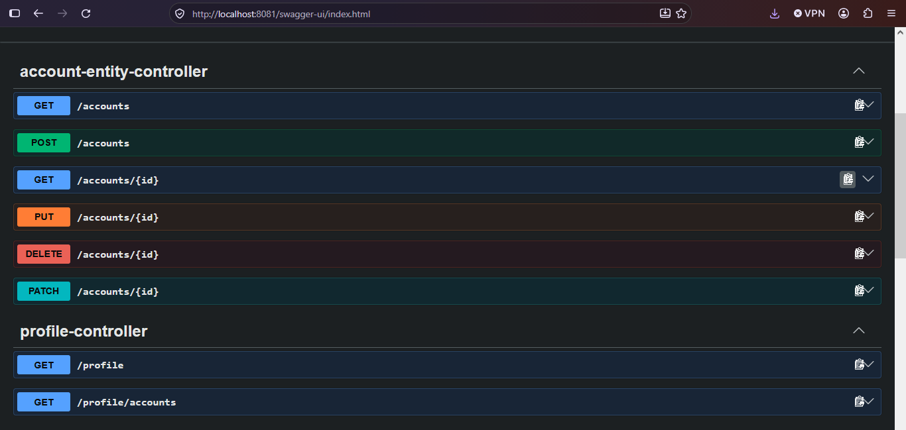 \
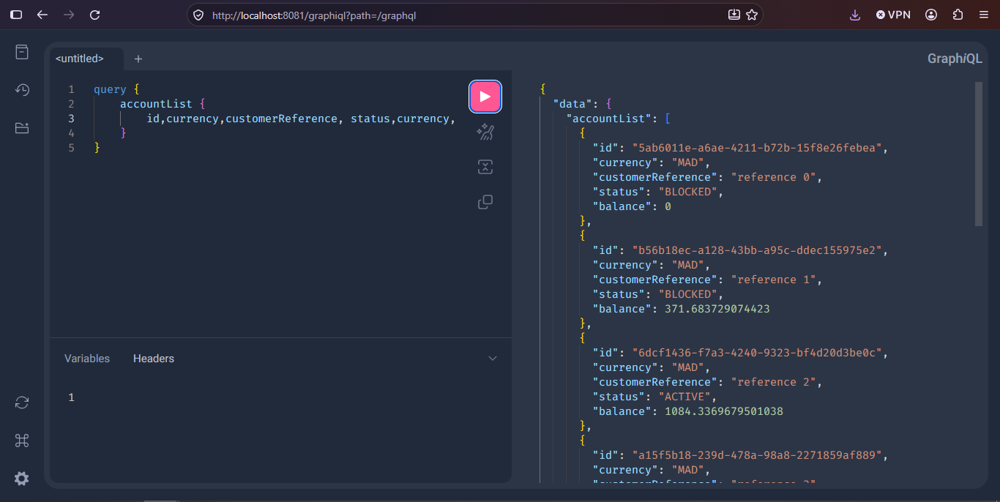 \
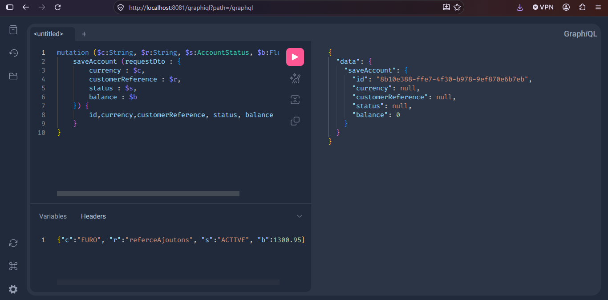 

### Transaction-Service et communication via OpenFeign :
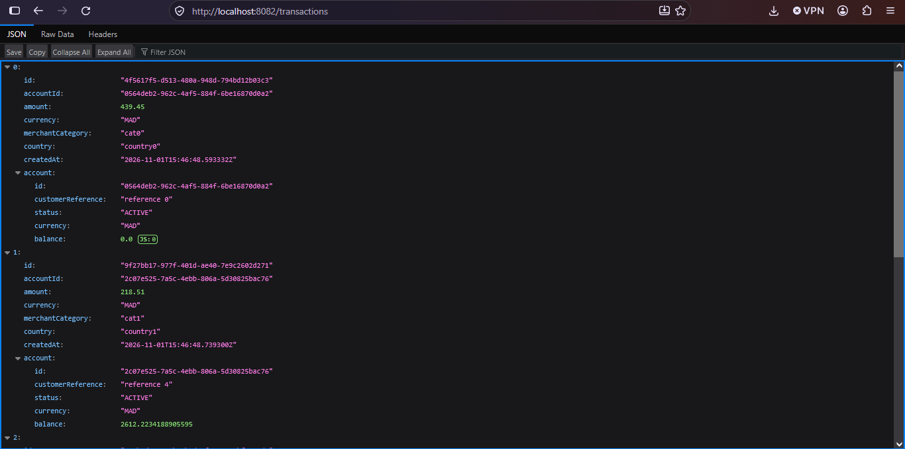 \
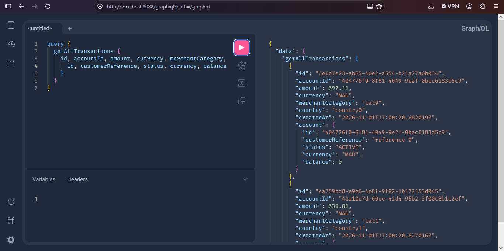 \
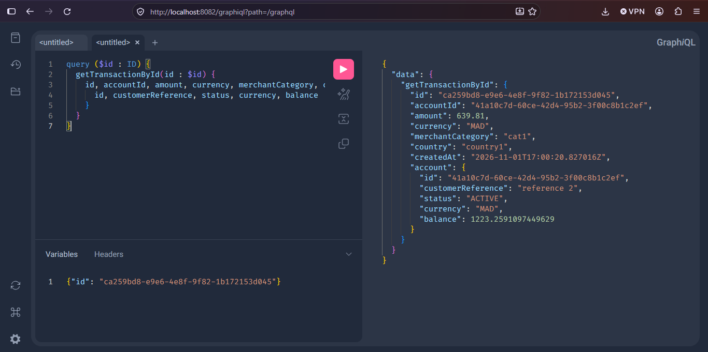 \
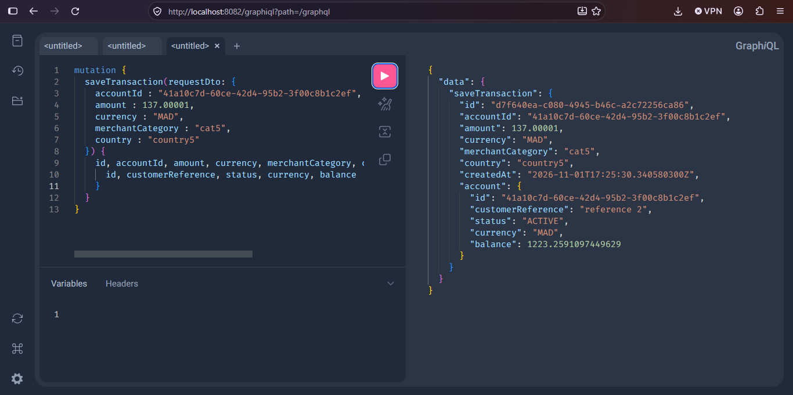 \
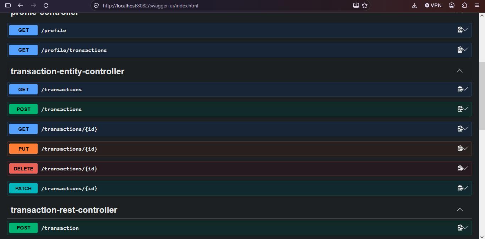 

### Une solution de tolérance aux pannes basée sur Resilience4J :
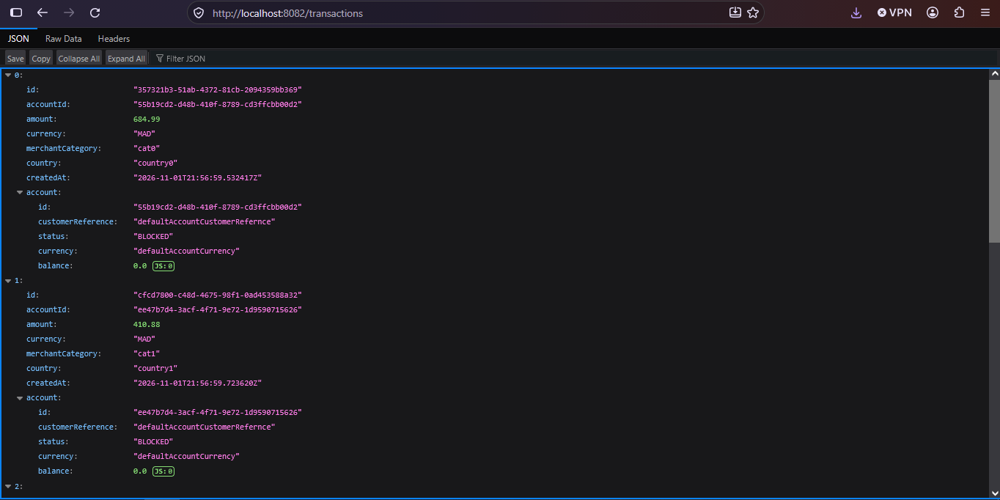 

## Partie D — Développer les micro-services techniques :
### Spring Cloud Gateway et Eureka Discovery service :
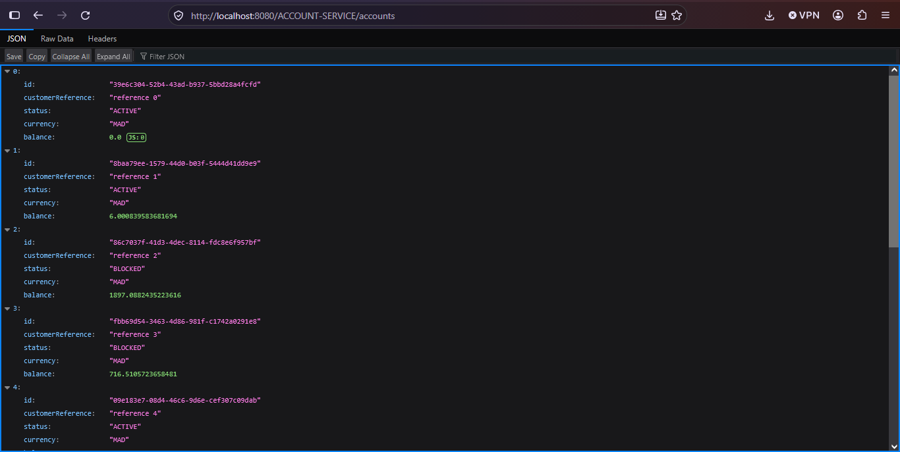 \
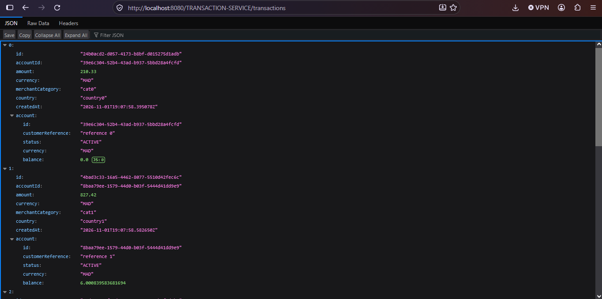 

### Config- service avec un un paramètre bank.transaction.max-amount=1000

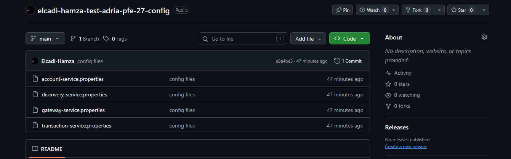 \

GITHUB REPO : https://github.com/Elcadi-Hamza/elcadi-hamza-test-adria-pfe-27-config

